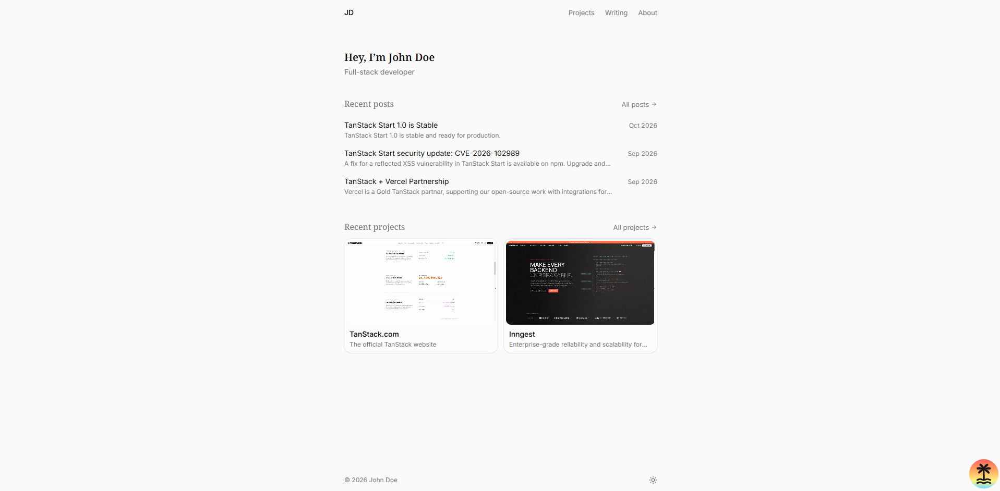

# TanStack Start + Notion Starter



A blog and portfolio template built with [TanStack Start](https://tanstack.com/start). All of the content (posts, projects, the About page, work history, and footer links) lives in one Notion database, so once it's set up you only ever edit Notion.

- Server-rendered React with type-safe file routing
- Posts and projects with covers, tags, and full Notion page bodies
- Syntax-highlighted code blocks (Shiki), light and dark themes
- Sitemap, RSS feed, robots.txt, and Open Graph tags built from your content
- Sample content until Notion is connected, and a banner that explains any setup problem

## Quick start

Click **Use this template** on GitHub to make your own copy, or clone it directly. You need Node.js 20.19 or newer and [pnpm](https://pnpm.io/installation) (`corepack enable` installs the version this repo pins).

```bash
git clone https://github.com/jefferypippitt/tanstack-notion-starter.git my-site
cd my-site
pnpm install
pnpm setup:notion
pnpm dev
```

The site runs at [http://localhost:43210](http://localhost:43210).

`pnpm setup:notion` walks you through connecting Notion:

1. It asks for an **integration secret**. Create one at [notion.so/my-integrations](https://www.notion.so/my-integrations) (**New integration**, pick your workspace) and copy the secret, which starts with `ntn_`.
2. It asks for a **page link**. Create an empty page in Notion, click **•••** → **Connections**, add your integration, then copy the page's link.
3. It creates a **Content** database inside that page with every column the site reads, and offers to fill it with demo posts, projects, and an About page.

Both answers are saved to `.env`, which is gitignored. Then edit, add, or delete rows in Notion: changes show up on the next page load.

> You can also fill in `.env` yourself: copy `.env.example`, set the two values, and run `pnpm setup:notion --seed` (or `--no-seed` to start empty).

## Content model

Every row has a **Type**, and only rows with **Published** checked appear on the site.

| Type | What it is | Columns it uses |
| --- | --- | --- |
| `Post` | A blog post | Title, Slug, Date, Tags, Summary, Cover |
| `Project` | A portfolio project | Title, Slug, Date, Tags, Description, Cover Video, Cover, Featured, Repo URL, Live URL |
| `About` | The About page text | Title (anything); the page body is the text |
| `Experience` | A role on the About page | Title (your role), Company, Date (with an end date; leave it empty for a current role) |
| `Link` | An icon in the footer | Title (the label, e.g. "GitHub"), URL |

- A post's or project's **page body** becomes the article.
- A post's **Cover** falls back to the Notion page cover. A project's **Cover Video** plays on its card and page; set its **Cover** to the clip's first frame (`ffmpeg -i clip.mp4 -frames:v 1 clip.jpg`) and it shows while the video loads, with no visible switch.
- **Featured** projects are listed first on the Projects page.
- Footer icons are picked from the link's domain (a globe for anything unrecognized), in the order the rows were created.

Supported blocks: paragraphs, headings, bulleted and numbered lists, code, quotes, callouts, dividers, images, bookmarks, and toggles.

Already have a database? Put its ID in `NOTION_DATABASE_ID` and run `pnpm setup:notion`. It adds any missing columns and Type options and never changes existing rows, so it's safe to run again any time.

<details>
<summary>Separate databases instead of one</summary>

Create a Posts and a Projects database (and optionally a third for Link, Experience, and About rows) with the columns above, connect each to your integration, and set these in `.env` instead of `NOTION_DATABASE_ID`:

```bash
NOTION_POSTS_DATABASE_ID=your_posts_database_id
NOTION_PROJECTS_DATABASE_ID=your_projects_database_id
NOTION_PROFILE_DATABASE_ID=your_profile_database_id
```

`pnpm setup:notion` only handles the single-database setup.
</details>

## Customize

**Site details** are in `src/config/site.ts`: your name (the header shows its initials), the intro line on the home page, the description used for SEO, your domain, and how many projects and posts the home page shows. Set `url` to your domain before deploying so the sitemap and RSS links point there.

**Styles** are in `src/styles.css`. Colors are [shadcn/ui](https://ui.shadcn.com) tokens (`--background`, `--primary`, and so on) defined for light and dark mode, with a `--surface-*` scale for layered backgrounds and `--fs-*` / `--lh-*` variables for the type scale.

**Components** are in `src/components/`:

| File | What it renders |
| --- | --- |
| `header.tsx`, `footer.tsx` | Navigation and footer links |
| `home.tsx` | The home page |
| `post-list.tsx`, `project-card.tsx` | Post and project listings |
| `article-layout.tsx`, `cover-media.tsx` | Post and project pages, with their covers |
| `notion-renderer.tsx` | Notion blocks |
| `about-section.tsx` | The About page |
| `ui/` | shadcn/ui components |

**Routes** are files in `src/routes/`. Add `src/routes/contact.tsx` and it's served at `/contact`.

## Deploy to Vercel

[](https://vercel.com/new/clone?repository-url=https://github.com/jefferypippitt/tanstack-notion-starter&env=NOTION_API_KEY,NOTION_DATABASE_ID)

Or import the repository at [vercel.com/new](https://vercel.com/new). Vercel uses pnpm because of `pnpm-lock.yaml`. Add `NOTION_API_KEY` and `NOTION_DATABASE_ID` from your `.env` as environment variables (run `pnpm setup:notion` locally first, so the ID is the database's and not the page's).

The server is built by [Nitro](https://nitro.build) (the `nitro()` plugin in `vite.config.ts`), which detects Vercel, Netlify, Cloudflare, and other hosts automatically. Anywhere else, `pnpm build` produces a Node server you can start with `node .output/server/index.mjs`.

## How it works

- **Notion is read on every request**, on the server only, so the API key never reaches the browser and published changes appear right away. Pages are as fast as the Notion API is.
- **Uploaded files** come from Notion as links that expire after an hour. Covers go through `/media/...`, which looks up a fresh link each time. Images inside a page body are linked directly: they're fresh on each load, but a tab left open for over an hour can lose them. Use an external image URL if that matters.
- **sitemap.xml, rss.xml, and robots.txt** are generated from your content and cached for an hour.

## AI agent skills

The repo includes the [shadcn/ui](https://ui.shadcn.com) agent skills, so coding agents know how to add and style this project's components (`components.json` holds the shadcn config). They live in `.agents/skills/`, with a copy in `.claude/skills/` for Claude Code, and `skills-lock.json` records their source. Delete those folders if you don't use an AI agent.

## Scripts

| Command | What it does |
| --- | --- |
| `pnpm dev` | Start the dev server on port 43210 |
| `pnpm build` | Build for production |
| `pnpm preview` | Serve the production build |
| `pnpm typecheck` | Type-check the project |
| `pnpm setup:notion` | Connect Notion and create or complete the database (`--seed` / `--no-seed` for demo content) |

## Troubleshooting

**The site shows sample content or a setup banner.** The banner says what's wrong and how to fix it. Most problems (a rejected secret, an ID that's a page instead of a database, missing columns) are fixed by running `pnpm setup:notion` and restarting `pnpm dev`.

**"Notion can't find" the page or database.** Open it in Notion, click **•••** → **Connections**, and add your integration.

**Build errors after changing dependencies.**

```bash
rm -rf node_modules .tanstack .output
pnpm install
```

## License

MIT
